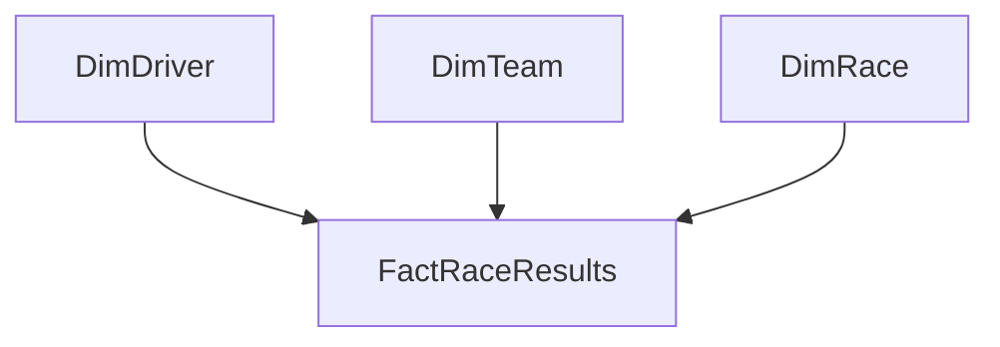

# Clase 01 — Interactividad y modelo estrella con Power BI

**Diplomado:** Análisis de Datos e Inteligencia de Negocios — Unimayor  
**Módulo 2 V2.0:** Analítica avanzada, IA y toma de decisiones con Power BI  
**Tema:** Diseño y personalización de informes interactivos  
**Duración sugerida:** 4 a 5 horas  
**Caso:** Formula 1 — primeros 4 Grandes Premios de 2024

---

## 1. Objetivo del laboratorio

En este ejercicio construiremos un informe completo que permita explicar dos ideas de forma práctica:

1. **cómo organizar datos mediante un modelo estrella**;
2. **cómo convertir un reporte en una experiencia interactiva**.

Al finalizar, el estudiante deberá tener un informe con:

- una tabla de hechos y tres dimensiones;
- relaciones 1:* de dirección única;
- medidas básicas;
- una página de resumen;
- una página de pilotos;
- una página de escuderías;
- una página de drillthrough;
- una página de tooltip;
- bookmarks;
- botones;
- navegador de páginas;
- un flujo de navegación que funcione de principio a fin.

---

# PARTE A — Preparar el modelo estrella

## 2. Archivos del ejercicio

Dentro de `data/raw/` encontrarás:

```text
race_results_2024_first4gp.csv
calendar_2024_first4gp.csv
drivers_2024.csv
```

Si el grupo se retrasa o necesitas recuperar rápidamente a un estudiante, en `data/model/` están las tablas ya preparadas:

```text
FactRaceResults.csv
DimDriver.csv
DimTeam.csv
DimRace.csv
```

> La carpeta `model/` es un respaldo. La ruta recomendada de clase es construir el modelo desde `raw/`.

---

## 3. Entender el grano antes de abrir Power BI

Pregunta:

> ¿Qué representa una fila de `race_results_2024_first4gp.csv`?

Respuesta esperada:

> **El resultado de un piloto en una carrera.**

Ese será el grano de nuestra tabla de hechos.

En un modelo estrella:

- la **tabla de hechos** contiene eventos y métricas;
- las **dimensiones** describen el contexto de esos eventos.

Nuestro modelo final será:



---

## 4. Cargar los archivos

1. Abre **Power BI Desktop**.
2. Selecciona **Inicio > Obtener datos > Texto/CSV**.
3. Carga los tres archivos de `data/raw/`.
4. En cada vista previa selecciona **Transformar datos**.

En Power Query, renombra las consultas:

| Archivo | Consulta |
|---|---|
| `race_results_2024_first4gp.csv` | `stg_results` |
| `calendar_2024_first4gp.csv` | `stg_calendar` |
| `drivers_2024.csv` | `stg_drivers` |

`stg` significa *staging*: consultas de preparación que no necesariamente estarán visibles para el usuario final.

---

## 5. Crear `FactRaceResults`

### Paso 1 — Crear una referencia

1. Clic derecho sobre `stg_results`.
2. Selecciona **Referencia**.
3. Renombra la nueva consulta:

```text
FactRaceResults
```

### Paso 2 — Combinar con el calendario

Necesitamos llevar `Round`, `Race Date` y una clave de carrera a la tabla de hechos.

1. Selecciona `FactRaceResults`.
2. Ve a **Inicio > Combinar consultas**.
3. Primera tabla: `FactRaceResults`.
4. Segunda tabla: `stg_calendar`.
5. Selecciona `Track` en ambas tablas.
6. Tipo de unión: **Left Outer / Externa izquierda**.
7. Acepta.
8. Expande la nueva columna y conserva solamente:
   - `Round`
   - `Race Date`

### Paso 3 — Crear `RaceKey`

Ve a **Agregar columna > Columna personalizada**.

Nombre:

```text
RaceKey
```

Fórmula:

```powerquery
"2024-R" & Text.PadStart(Text.From([Round]), 2, "0")
```

Ejemplos:

```text
2024-R01
2024-R02
2024-R03
2024-R04
```

### Paso 4 — Crear posición numérica

`Position` contiene números y también `NC`.

Crea:

```text
PositionNumeric
```

con:

```powerquery
try Number.FromText([Position]) otherwise null
```

### Paso 5 — Crear estado del resultado

Crea:

```text
ResultStatus
```

con:

```powerquery
if [Position] = "NC" then "No clasificado" else "Clasificado"
```

### Paso 6 — Renombrar campos para que sean consistentes

Renombra:

```text
Driver          → DriverKey
Team            → TeamKey
Starting Grid   → StartingGrid
Time/Retired    → TimeRetired
Set Fastest Lap → SetFastestLap
Fastest Lap Time → FastestLapTime
Race Date       → RaceDate
```

### Paso 7 — Tipos de datos

Verifica:

| Campo | Tipo |
|---|---|
| `Round` | Número entero |
| `RaceDate` | Fecha |
| `PositionNumeric` | Número entero |
| `StartingGrid` | Número entero |
| `Laps` | Número entero |
| `Points` | Número decimal |
| `DriverKey` | Texto |
| `TeamKey` | Texto |
| `RaceKey` | Texto |

---

## 6. Crear `DimRace`

1. Clic derecho en `stg_calendar`.
2. **Referencia**.
3. Renombra:

```text
DimRace
```

4. Crea `RaceKey`:

```powerquery
"2024-R" & Text.PadStart(Text.From([Round]), 2, "0")
```

5. Cambia `Race Date` a **Fecha**.
6. Renombra campos para que sean legibles, por ejemplo:
   - `Race Date` → `RaceDate`
   - `GP Name` → `GPName`
   - `Circuit Name` → `CircuitName`
   - `Number of Laps` → `NumberOfLaps`

7. Comprueba que `RaceKey` no tenga duplicados.

Debe haber **4 filas**.

---

## 7. Crear `DimDriver`

1. Clic derecho en `stg_drivers`.
2. **Referencia**.
3. Renombra:

```text
DimDriver
```

4. Conserva como mínimo:

```text
Driver
Abbreviation
Country
Date of Birth
Place of Birth
```

5. Renombra:

```text
Driver        → DriverKey
Date of Birth → DateOfBirth
Place of Birth → PlaceOfBirth
```

6. Cambia `DateOfBirth` a tipo **Fecha**.
7. Comprueba que `DriverKey` sea único.

> La dimensión puede contener pilotos que no aparecen en estas cuatro carreras. No hay problema: la relación filtrará únicamente los que tengan hechos.

---

## 8. Crear `DimTeam`

La vamos a derivar desde la propia tabla de resultados para conservar exactamente las claves usadas por la tabla de hechos.

1. Clic derecho en `stg_results`.
2. Selecciona **Referencia**.
3. Renombra:

```text
DimTeam
```

4. Conserva únicamente `Team`.
5. Selecciona `Team`.
6. Ve a **Inicio > Quitar filas > Quitar duplicados**.
7. Renombra:

```text
Team → TeamKey
```

Opcionalmente crea `TeamShort` con **Agregar columna > Columna condicional** para mostrar nombres más cortos:

```text
Red Bull Racing Honda RBPT   → Red Bull Racing
McLaren Mercedes             → McLaren
Aston Martin Aramco Mercedes → Aston Martin
Kick Sauber Ferrari          → Kick Sauber
Haas Ferrari                 → Haas
RB Honda RBPT                → RB
Williams Mercedes            → Williams
Alpine Renault               → Alpine
Ferrari                      → Ferrari
Mercedes                     → Mercedes
```

---

## 9. Deshabilitar carga de consultas staging

En Power Query:

1. Clic derecho en `stg_results`.
2. Desmarca **Habilitar carga**.
3. Repite con:
   - `stg_calendar`
   - `stg_drivers`

Las consultas staging seguirán existiendo, pero no ensuciarán el modelo.

Selecciona:

**Inicio > Cerrar y aplicar**.

---

## 10. Construir las relaciones

Ve a **Vista Modelo**.

Crea:

```text
DimDriver[DriverKey]  1 ───── * FactRaceResults[DriverKey]

DimTeam[TeamKey]      1 ───── * FactRaceResults[TeamKey]

DimRace[RaceKey]      1 ───── * FactRaceResults[RaceKey]
```

En las tres relaciones usa:

- cardinalidad: **Uno a varios (1:*)**;
- dirección de filtro cruzado: **Única**;
- dirección lógica: **dimensión → hechos**;
- relación: **Activa**.

### Comprobación

Tu modelo debe verse como una estrella, con `FactRaceResults` en el centro.

### Si una relación aparece como muchos a muchos

Detente.

Eso significa que el campo que debería ser clave en la dimensión contiene duplicados o no estás utilizando la columna correcta.

---

# PARTE B — Medidas mínimas para el informe

## 11. Crear las medidas

Crea una tabla de medidas o guárdalas en `FactRaceResults`.

### Puntos

```DAX
Puntos =
SUM(FactRaceResults[Points])
```

### Carreras

```DAX
Carreras =
DISTINCTCOUNT(FactRaceResults[RaceKey])
```

### Victorias

```DAX
Victorias =
CALCULATE(
    COUNTROWS(FactRaceResults),
    FactRaceResults[PositionNumeric] = 1
)
```

### Podios

```DAX
Podios =
CALCULATE(
    COUNTROWS(FactRaceResults),
    FactRaceResults[PositionNumeric] <= 3
)
```

### Promedio de llegada

```DAX
Promedio Posición =
AVERAGEX(
    FILTER(
        FactRaceResults,
        NOT ISBLANK(FactRaceResults[PositionNumeric])
    ),
    FactRaceResults[PositionNumeric]
)
```

### Posiciones ganadas

```DAX
Posiciones Ganadas =
SUMX(
    FILTER(
        FactRaceResults,
        NOT ISBLANK(FactRaceResults[PositionNumeric]) &&
        FactRaceResults[StartingGrid] > 0
    ),
    FactRaceResults[StartingGrid] -
    FactRaceResults[PositionNumeric]
)
```

### Piloto seleccionado

```DAX
Piloto Seleccionado =
SELECTEDVALUE(
    DimDriver[DriverKey],
    "Todos los pilotos"
)
```

---

# PARTE C — Construir el informe base

## 12. Crear las páginas

Crea estas páginas:

```text
01 Resumen
02 Pilotos
03 Escuderías
04 Detalle Piloto
TT Piloto
```

Más adelante ocultaremos las dos últimas.

---

## 13. Página `01 Resumen`

Agrega:

### KPI

- `[Puntos]`
- `[Victorias]`
- `[Podios]`
- `[Carreras]`

### Visual 1 — Puntos por piloto

- Gráfico: barras.
- Eje: `DimDriver[DriverKey]`.
- Valor: `[Puntos]`.

### Visual 2 — Puntos por escudería

- Gráfico: barras.
- Eje: `DimTeam[TeamShort]` o `TeamKey`.
- Valor: `[Puntos]`.

### Visual 3 — Puntos por carrera

- Gráfico: columnas.
- Eje: `DimRace[Track]`.
- Valor: `[Puntos]`.
- Orden: `DimRace[Round]`.

### Segmentadores

Agrega:

- `DimRace[Track]`;
- `DimDriver[DriverKey]`;
- `DimTeam[TeamShort]`.

Prueba que los tres segmentadores afecten los visuales. Si no ocurre, revisa las relaciones antes de continuar.

---

# PARTE D — BOOKMARKS

## 14. Ejercicio: panel de filtros que se abre y cierra

Los bookmarks guardan estados del informe. Para este ejercicio los usaremos para controlar **visibilidad**, no para cambiar filtros.

### Paso 1 — Abrir los paneles

Ve a:

```text
Vista > Paneles > Selección
Vista > Paneles > Marcadores
```

### Paso 2 — Diseñar el panel

En `01 Resumen`:

1. Inserta un rectángulo en el lado derecho.
2. Coloca encima los tres segmentadores.
3. Agrega un texto `Filtros`.
4. Inserta un botón pequeño `X` para cerrar.

Selecciona esos objetos en el panel **Selección** y agrúpalos si quieres facilitar el trabajo.

### Paso 3 — Crear bookmark `Filtros abiertos`

1. Deja visibles:
   - rectángulo;
   - segmentadores;
   - título;
   - botón X.
2. Selecciona **solo esos objetos** en el panel Selección.
3. En Marcadores selecciona **Agregar**.
4. Renombra:

```text
Filtros abiertos
```

5. En `...` del bookmark configura:
   - **Data / Datos: desactivado**
   - **Display / Visualización: activado**
   - **Current page / Página actual: desactivado**
   - **Selected visuals / Objetos visuales seleccionados**

### Paso 4 — Crear bookmark `Filtros cerrados`

1. Oculta el grupo de filtros desde el icono del ojo en Selección.
2. Deja seleccionado el mismo grupo de objetos.
3. Agrega otro bookmark.
4. Renombra:

```text
Filtros cerrados
```

5. Usa la misma configuración:
   - Datos: OFF
   - Visualización: ON
   - Página actual: OFF
   - Objetos visuales seleccionados

### Paso 5 — Probar

Haz clic en los bookmarks desde el panel.

El panel debe aparecer y desaparecer.

**Muy importante:** una selección hecha en un slicer antes de cerrar el panel debe mantenerse.

### Si el bookmark borra los filtros

Revisa `... > Datos`.

Debe estar **desactivado** para estos dos bookmarks.

### Si cambias algo y el bookmark sigue mostrando el estado anterior

Haz:

```text
... del bookmark > Actualizar
```

---

# PARTE E — BUTTONS

## 15. Botones para abrir y cerrar el panel

### Botón Abrir filtros

1. **Insertar > Botones > En blanco**.
2. Escribe `Filtros` o usa un icono reconocible.
3. En el panel Formato activa:
   - **Acción: On**
   - **Tipo: Bookmark / Marcador**
   - **Bookmark: Filtros abiertos**

### Botón Cerrar

Selecciona el botón `X` dentro del panel:

- Acción: On
- Tipo: Bookmark
- Bookmark: `Filtros cerrados`

### Probar en Power BI Desktop

En modo edición debes usar:

```text
Ctrl + clic
```

Un clic normal solo selecciona el objeto.

---

## 16. Botón `Restablecer`

Este bookmark sí debe restaurar filtros.

1. Deja la página en el estado inicial deseado.
2. Limpia las selecciones de los slicers.
3. Abre Marcadores.
4. Agrega:

```text
Estado inicial
```

5. Configura:
   - **Datos: ON**
   - **Visualización: opcional**
   - **Página actual: OFF** si solo quieres restablecer el estado sin navegar.
   - **Todos los objetos visuales**.

6. Inserta un botón `Restablecer`.
7. Acción:
   - Tipo: Bookmark.
   - Bookmark: `Estado inicial`.

### Diferencia didáctica

- `Filtros abiertos/cerrados` → guardan **visibilidad**, por eso Datos está OFF.
- `Estado inicial` → guarda **filtros**, por eso Datos está ON.

---

# PARTE F — PAGE NAVIGATION

## 17. Construir la navegación principal

La navegación de páginas es preferible a crear manualmente un botón por cada página cuando queremos un menú estable.

### Paso 1 — Ocultar páginas técnicas

Haz clic derecho en:

```text
04 Detalle Piloto
TT Piloto
```

y selecciona **Ocultar página**.

No queremos que formen parte del menú principal.

### Paso 2 — Insertar navegador

En `01 Resumen`:

```text
Insertar > Botones > Navegador > Navegador de páginas
```

Power BI crea automáticamente botones para las páginas visibles.

Deberían aparecer:

```text
01 Resumen
02 Pilotos
03 Escuderías
```

### Paso 3 — Dar formato

En Formato del navegador:

- diferencia el estado **Seleccionado**;
- ajusta relleno, borde y tipografía;
- mantén el mismo lugar del menú en las tres páginas.

Copia el navegador a `02 Pilotos` y `03 Escuderías`.

### Prueba

En Power BI Desktop:

```text
Ctrl + clic
```

sobre cada página.

### Si aparecen páginas técnicas

1. Comprueba que `04 Detalle Piloto` y `TT Piloto` están ocultas.
2. Revisa la sección **Páginas** del formato del navegador.
3. Evita mostrar páginas ocultas o páginas de tooltip.

---

# PARTE G — DRILLTHROUGH

## 18. Crear `04 Detalle Piloto`

Queremos pasar de una barra resumida a una ficha del piloto seleccionado.

### Paso 1 — Configurar el campo de drillthrough

Abre `04 Detalle Piloto`.

En el panel de construcción del visual / filtros de drillthrough localiza:

```text
Drill-through / Obtención de detalles
```

Arrastra:

```text
DimDriver[DriverKey]
```

al área de drillthrough.

Activa **Mantener todos los filtros** si quieres conservar también carrera y escudería seleccionadas.

Power BI suele agregar automáticamente un botón Atrás cuando la página recibe un campo de drillthrough. Si no aparece:

```text
Insertar > Botones > Atrás
```

### Paso 2 — Diseñar la ficha

Agrega:

- tarjeta con `[Piloto Seleccionado]`;
- `[Puntos]`;
- `[Podios]`;
- `[Victorias]`;
- `[Promedio Posición]`;
- `[Posiciones Ganadas]`;
- gráfico por `DimRace[Track]` y `[Puntos]`;
- tabla:
  - `DimRace[Track]`;
  - `FactRaceResults[StartingGrid]`;
  - `FactRaceResults[PositionNumeric]`;
  - `FactRaceResults[Points]`.

### Paso 3 — Probar drillthrough con clic derecho

1. Regresa a `01 Resumen`.
2. En el gráfico **Puntos por piloto**, haz clic derecho sobre una barra.
3. Selecciona:
   - **Drill through / Obtener detalles**
   - `04 Detalle Piloto`
4. La página debe abrir filtrada por ese piloto.

### Si no aparece la opción de drillthrough

Comprueba:

1. que el campo en destino sea exactamente `DimDriver[DriverKey]`;
2. que el visual origen use `DimDriver[DriverKey]`;
3. que exista una relación activa hacia `FactRaceResults`;
4. que hayas seleccionado un punto de datos concreto;
5. que no estés intentando hacerlo desde un visual que no aporta ese contexto.

---

## 19. Botón de drillthrough opcional

También puedes permitir que el usuario seleccione una barra y pulse un botón.

1. Inserta un botón.
2. Acción: **On**.
3. Tipo: **Drill through**.
4. Destino: `04 Detalle Piloto`.

Cuando no exista un único piloto seleccionado, Power BI mostrará el botón en estado deshabilitado.

Esta opción sirve para enseñar la diferencia entre:

- drillthrough por clic derecho;
- drillthrough mediante botón.

---

# PARTE H — TOOLTIPS PERSONALIZADOS

## 20. Crear página `TT Piloto`

Un tooltip de página permite mostrar contexto adicional sin salir de la visualización principal.

### Paso 1 — Configurar la página

Selecciona `TT Piloto`.

En formato de página:

1. **Información de página > Tooltip: On**.
2. **Canvas settings / Configuración del lienzo > Type / Tipo: Tooltip**.

Mantén la página oculta.

### Paso 2 — Diseñar el tooltip

Usa poco contenido:

- `DimDriver[DriverKey]`;
- `[Puntos]`;
- `[Podios]`;
- `[Promedio Posición]`;
- `[Posiciones Ganadas]`.

Opcional: un mini gráfico con `DimRace[Track]` y `[Puntos]`.

### Paso 3 — Asociarlo al gráfico

Regresa a `01 Resumen`.

Selecciona el gráfico **Puntos por piloto**.

Ve a:

```text
Formato > General > Tooltips / Información sobre herramientas
```

Configura:

- Tooltips: **On**
- Tipo: **Report page / Página de informe**
- Página: `TT Piloto`

### Paso 4 — Probar

Pasa el cursor sobre diferentes pilotos.

El contenido debe cambiar con el piloto sobre el que estás haciendo hover.

### Si el tooltip no cambia

Comprueba:

1. que el visual origen incluya `DimDriver[DriverKey]`;
2. que la página tenga Tooltip activado;
3. que el tamaño de lienzo sea Tooltip;
4. que el tooltip del visual sea del tipo Página de informe;
5. que la página elegida sea `TT Piloto`;
6. que las relaciones del modelo estén activas.

---

# PARTE I — Integrar todo en un único flujo

## 21. Flujo final esperado

```text
                           ┌────────────────────┐
                           │     01 Resumen     │
                           └─────────┬──────────┘
                                     │
                ┌────────────────────┼────────────────────┐
                │                    │                    │
                ▼                    ▼                    ▼
       Bookmarks + Buttons    Page Navigator      Hover sobre piloto
        abre/cierra filtros    02 / 03 páginas       TT Piloto
                │
                │
                └───────────────┐
                                ▼
                       Seleccionar un piloto
                                │
                      Drillthrough / botón
                                ▼
                     ┌────────────────────┐
                     │ 04 Detalle Piloto  │
                     └─────────┬──────────┘
                               │
                          Botón Atrás
                               │
                               ▼
                          página origen
```

---

# PARTE J — Comprobaciones de funcionamiento

## 22. Checklist técnico

### Modelo estrella

- [ ] `FactRaceResults` está en el centro.
- [ ] `DimDriver` tiene una fila por piloto.
- [ ] `DimTeam` tiene una fila por escudería.
- [ ] `DimRace` tiene una fila por carrera.
- [ ] Las relaciones son 1:*.
- [ ] El filtro fluye de dimensión a hechos.
- [ ] No existen relaciones muchos a muchos.

### Bookmarks

- [ ] `Filtros abiertos` muestra el panel.
- [ ] `Filtros cerrados` lo oculta.
- [ ] Ambos tienen **Datos desactivado**.
- [ ] Ambos usan **Visualización**.
- [ ] Los slicers conservan su selección al cerrar el panel.

### Buttons

- [ ] Abrir filtros activa `Filtros abiertos`.
- [ ] Cerrar filtros activa `Filtros cerrados`.
- [ ] Restablecer activa `Estado inicial`.
- [ ] En Desktop se prueban con Ctrl + clic.

### Page Navigation

- [ ] Navega entre `01 Resumen`, `02 Pilotos` y `03 Escuderías`.
- [ ] La página activa se distingue visualmente.
- [ ] No aparecen `04 Detalle Piloto` ni `TT Piloto`.

### Drillthrough

- [ ] `DimDriver[DriverKey]` está en el área de drillthrough.
- [ ] Al entrar desde un piloto, la página queda filtrada.
- [ ] El botón Atrás devuelve al contexto anterior.

### Tooltip

- [ ] `TT Piloto` tiene Tooltip = On.
- [ ] El lienzo es de tipo Tooltip.
- [ ] El gráfico usa una página de informe como tooltip.
- [ ] Cambia según el piloto sobre el que se hace hover.

---

# PARTE K — Errores frecuentes

## 23. “El botón no hace nada”

En Power BI Desktop, si estás editando el informe:

```text
Ctrl + clic
```

Un clic normal selecciona el botón.

---

## 24. “El bookmark me borra los filtros”

Para bookmarks que solo controlan visibilidad:

```text
Datos = OFF
Visualización = ON
```

---

## 25. “Oculté el slicer, pero el filtro sigue aplicado”

Eso es correcto.

Ocultar un slicer no elimina su estado. Solo cambia su visibilidad.

Para borrar su filtro debes:

- limpiar el slicer; o
- activar un bookmark como `Estado inicial` que capture Datos.

---

## 26. “No aparece Drillthrough”

Revisa que el campo del área de drillthrough también exista en el contexto del visual origen.

Para esta práctica usa exactamente:

```text
DimDriver[DriverKey]
```

en ambos lugares.

---

## 27. “El navegador muestra páginas que no quiero”

Oculta las páginas técnicas y revisa:

```text
Formato del navegador > Páginas
```

No muestres páginas ocultas ni tooltips.

---

## 28. “El tooltip aparece vacío”

Usa medidas que respondan al contexto del piloto.

Evita colocar información que no esté relacionada con `DimDriver`.

---

# PARTE L — Reto final

## 29. Reto de 30 minutos

Sin copiar exactamente el informe del instructor, crea una experiencia que responda:

> ¿Qué piloto y qué escudería tuvieron el mejor rendimiento durante los cuatro primeros Grandes Premios de 2024 y cómo cambió ese rendimiento de una carrera a otra?

Requisitos:

1. modelo estrella funcional;
2. mínimo 3 KPI;
3. gráfico por piloto;
4. gráfico por escudería;
5. navegador de páginas;
6. panel de filtros controlado por bookmarks;
7. botón de restablecimiento;
8. drillthrough de piloto;
9. tooltip personalizado;
10. una conclusión de negocio/deportiva escrita en una frase.

---

# PARTE M — Preguntas de cierre

1. ¿Qué diferencia existe entre ocultar un slicer y limpiar su filtro?
2. ¿Por qué un bookmark de visibilidad normalmente debe tener `Data` desactivado?
3. ¿Qué condición debe existir para que un drillthrough funcione?
4. ¿Qué ventaja tiene Page Navigator frente a crear botones uno por uno?
5. ¿Qué información debería ir a un tooltip y qué información merece una página de detalle?
6. ¿Cuál es el grano de `FactRaceResults`?
7. ¿Por qué las dimensiones deben tener claves únicas?
8. ¿Qué problema evitaríamos manteniendo relaciones 1:* y filtros en una sola dirección?

---

# Fuentes y documentación

## Dataset

Repositorio:

https://github.com/toUpperCase78/formula1-datasets

Resultados 2024:

https://raw.githubusercontent.com/toUpperCase78/formula1-datasets/master/Formula1_2024season_raceResults.csv

Calendario 2024:

https://raw.githubusercontent.com/toUpperCase78/formula1-datasets/master/Formula1_2024season_calendar.csv

Pilotos 2024:

https://raw.githubusercontent.com/toUpperCase78/formula1-datasets/master/Formula1_2024season_drivers.csv

## Power BI — documentación oficial

Bookmarks:

https://learn.microsoft.com/power-bi/create-reports/desktop-bookmarks

Buttons:

https://learn.microsoft.com/power-bi/create-reports/desktop-buttons

Page Navigator:

https://learn.microsoft.com/power-bi/create-reports/button-navigators

Drillthrough:

https://learn.microsoft.com/power-bi/create-reports/desktop-drillthrough

Tooltips:

https://learn.microsoft.com/power-bi/visuals/power-bi-visualization-tooltips-overview

> Las etiquetas de la interfaz pueden variar ligeramente según el idioma o la versión de Power BI Desktop. La lógica de configuración indicada en esta guía corresponde a la documentación oficial vigente consultada para esta versión del curso.
